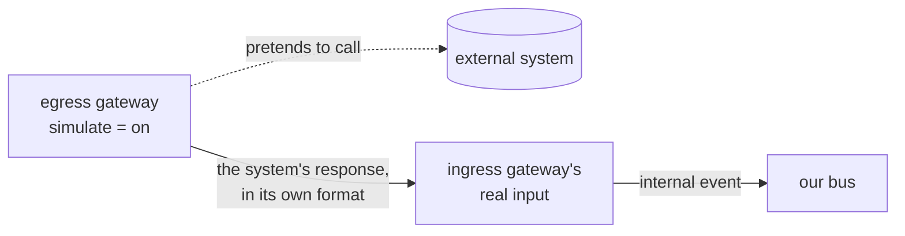

# Payments Mock Systems Specifications

*How to run and test the payment subsystem in [PaymentsServiceSpecs.md](PaymentsServiceSpecs.md) without the real outside world: the book's tests for every service, one event-injection script for live demos, a simulation mode in the egress gateways in place of the external systems, and the two neighbouring subsystems as configuration rather than code.*

**Running example:** payment `p-7`, 100 from checking account `C-1` to card `K-2`, same as the service specs.
**What's the book's and what's ours:** the testing levels in layer 1 (connector mocks, record-and-replay test doubles, a local emulator for the handlers, consumer-driven contract tests, transitive end-to-end tests) are the book's. So is the idea that event-first services can be tested by simulating upstream events. The injection script, the simulation mode, the external systems' formats and codes, the seed accounts and the scenarios are **ours**.
**Layer 1 follows the author's approach (2026-11-07):** record-and-replay (VCR) test doubles and a lightweight local emulator for the handlers, not full integration tests against an AWS emulator. The author prefers this because it has "fewer headaches" and the connectors still hit real resources when recording.
**Tech stack:** like the service specs, this file names capabilities, not products. We won't use the book's TypeScript framework, so layer 1 takes the book's *techniques*, not its tools. The book uses Replay or Polly.js for VCR recordings, `serverless-offline` as the emulator and its `baton-*` modules for contract tests; the equivalents in our stack are chosen with the framework.

## The approach

| Layer | What | Effort | Shows | Doesn't show |
|---|---|---|---|---|
| [1. Tests in the book's style](#1-tests-in-the-books-style) | Unit, integration and contract tests in every service | Part of building each service | Each pattern's logic, idempotence, order tolerance, contracts | Nothing to watch running |
| [2. Event injection](#2-event-injection) | One script that publishes internal events onto our bus | One small script | The saga, the BFF's view, the timeout, compensation, live | The gateways: it pretends to be them |
| [3. Simulated external systems](#3-simulated-external-systems) | Each egress gateway, in simulation mode, pretends to call its external system and feeds that system's response to the ingress gateway | A setting in three gateways | Both gateways of every external system doing their real translation, and the faults of the fault accounts | Faults without a fault account |
| [4. Neighbouring subsystems](#4-neighbouring-subsystems-as-configuration) | A downstream bus + a rule + a log; accounts as a publish script | Configuration | What crosses the boundary, in both directions | — |

**Not built:** stub services for the external systems, a control plane, a simulated clock, runtime fault switches (faults come from **fault accounts** instead), a load driver. Short timeouts and the injection script cover the time-based scenarios instead.

**Boundary rule:** only the gateways (ESGs) know about the external systems, real or simulated. The BFF and the control service can't tell the difference. Going from simulation to the real system means turning one setting off in one egress gateway (Ch. 7 › [Semantic transformation](Chapter_07_Bridging_Intersystem_Gaps.md#semantic-transformation)).

---

## 1. Tests in the book's style

The book's **serverless testing honeycomb**: most test cases hit the models; just enough hit the handlers and connectors (Ch. 11 › [Serverless testing honeycomb](Chapter_11_Choreographing_Deployment_and_Delivery.md#serverless-testing-honeycomb)).

| Level | Technique | In this subsystem |
|---|---|---|
| Function | **Unit tests** on the models, with **mock objects for the connectors** and emulated events for the handlers (Ch. 11 › [Unit testing](Chapter_11_Choreographing_Deployment_and_Delivery.md#unit-testing)) | The control service's rules (every row of its trigger table, including *late deposit*); the BFF's forward-only view updates; each ESG's mapping to and from the outside format |
| Service | **Integration tests** with **VCR recordings** (record once against the real resource, replay in CI) and a **lightweight local emulator** for the handlers (Ch. 11 › [Integration testing](Chapter_11_Choreographing_Deployment_and_Delivery.md#integration-testing)) | The BFF's `PUT`/`GET /payments` against its table; each ESG's connector recorded once against the real external system (or its sandbox) when one is available, and replayed in CI |
| Between services | **Contract tests**, consumer-driven (Ch. 11 › [Contract testing](Chapter_11_Choreographing_Deployment_and_Delivery.md#contract-testing)) | One per producer → consumer pair in the event catalog. For example, the control service's team adds a test to the Checking ESG asserting it still emits the recorded `FUNDS_WITHDRAWN` for a recorded ledger row |
| Subsystem | **Transitive end-to-end tests**: chained contracts, not everything running at once | `PAYMENT_SUBMITTED` → … → `PAYMENT_COMPLETED`, joined through the recorded events |

Because services react to events, each one can be built and tested in any order, with no other service running: "we can simulate upstream events" (Ch. 2 › [Invert responsibility for invocation](Chapter_02_Defining_Boundaries_and_Letting_Go.md#invert-responsibility-for-invocation)).

**Fixtures** are shared across tests and the injection script: one recorded event per type in the event catalog, all for `p-7`.

---

## 2. Event injection

*One script, `inject`, that publishes internal events onto our bus, standing in for whichever gateway would normally produce them.*

```
inject submit   p-7 --from C-1 --to K-2 --amount 100   # PUT /payments/p-7 on the BFF
inject withdrawn p-7                                   # as the Checking ESG
inject deposited p-7                                   # as the Card or Bank ESG
inject deposit-failed p-7 --reason account-closed
inject refunded  p-7
```

- `submit` goes through the BFF's real API, as customer `u-42` (the `X-Customer-Id` header), so the BFF publishes `PAYMENT_SUBMITTED` as usual. Everything else is put straight on the bus.
- Each injected event has the envelope of the real one, with `tags.source: inject`, so the lake shows which events were simulated.
- Event ids are deterministic (`<payment>-<type>`), so running the same line twice shows idempotence: nothing changes the second time.
- The control service's timeout is configured short for demos (for example 2 minutes, not 2 days). With nothing injected after `DEPOSIT_REQUESTED`, `PAYMENT_EXPIRED` appears on its own.

This is the quickest way to show the control service and the BFF. It skips every gateway, so the gateway lessons need the [simulated external systems](#3-simulated-external-systems).

---

## 3. Simulated external systems

*No stub services. Each egress gateway has a **simulation mode** (service specs › [Simulation mode](PaymentsServiceSpecs.md#simulation-mode-egress-esgs)): it pretends to call its external system, then delivers the response that system would have sent to the ingress gateway's real input. The ingress gateway can't tell the difference.*



Each simulated response uses the external system's **own dialect**, so the ingress gateway still does a real semantic transformation, and the `raw` field has something to show:

| Concept | Our internal events | Core checking | Card processor | Bank network |
|---|---|---|---|---|
| Reference | `payment.id` = `p-7` | `REF_NO` | `metadata.reference` | `reference` |
| Amount | `"100.00"` (decimal string) + `currency` | `AMT` = `100.00` | `amount_cents` = `10000` | `amount` = `100.00` |
| Failure | `reason: insufficient-funds`, `account-closed` | `REJ_CD`: `NSF`, `ACCT_CLSD` | `failure_code`: `card_closed` | `code`: `R02` closed, `R03` no account |

The account decides the outcome, the way a payment provider's test cards do: see the service specs › [Simulation mode](PaymentsServiceSpecs.md#simulation-mode-egress-esgs) for the table. In short, `C-2`, `K-3` and `B-8` fail, `B-7` settles after the deadline, and `C-1`, `K-2` and `B-9` succeed. Fault accounts succeed but misbehave on the way: `C-5` takes core checking down for everyone for a minute, `C-8`'s first request is lost and needs an operator, `C-7`'s debit is applied but the answer is lost, `K-6` gets its webhook twice and `B-6` its settlement file twice.

| External system | The egress gateway pretends to… | …and delivers to the ingress gateway | Lesson |
|---|---|---|---|
| **Core checking** (legacy) | call `POST /CHK/DEBIT` or `/CHK/CREDIT` | a **ledger entry** on the change feed it reads: `ENTRY_ID`, `ACCT_NO`, `AMT` (signed), `TXN_TYP` (`PMT`/`RFND`), `REF_NO`, `STAT` (`POSTED`/`REJECTED`), `REJ_CD` | "Act, then hear back": the answer comes from the ledger, not the call |
| **Card processor** (SaaS) | call `POST /v1/credits` and get `202` | a **signed webhook**, a few seconds later: `{ "event_id", "type": "credit.succeeded" \| "credit.failed", "data": { "credit_id", "reference", "failure_code" } }` | A `202` is a promise, not a fact |
| **Bank network** (batch) | send tonight's transfer file `PAY_<date>.csv` (`reference,account,amount,currency`) | a **settlement file** `SETTLE_<date>.csv` (`reference,status,code`) where it picks up files | Answers can take days |

- In simulation mode each egress gateway is configured with its ingress partner's input (service specs › [Simulation mode](PaymentsServiceSpecs.md#simulation-mode-egress-esgs)).
- The delay before each response is a setting per external system: a few seconds for the card processor, a few minutes for the bank network in demos. `B-7`'s settlement comes after the deadline.
- The change feed that the core checking ingress reads stands in for change data capture on the real transaction log ([Open questions](#open-questions)).

**Sources:** Ch. 7 › [Ingress – Change Data Capture](Chapter_07_Bridging_Intersystem_Gaps.md#ingress--change-data-capture), [Egress – API call](Chapter_07_Bridging_Intersystem_Gaps.md#egress--api-call), [Ingress – webhook](Chapter_07_Bridging_Intersystem_Gaps.md#ingress--webhook), [Dissecting the External Service Gateway pattern](Chapter_07_Bridging_Intersystem_Gaps.md#dissecting-the-external-service-gateway-pattern); Ch. 8 › [expire](Chapter_08_Reacting_to_Events_with_More_Events.md#expire).

---

## 4. Neighbouring subsystems as configuration

Both neighbours exist only to show **external domain events** crossing a subsystem boundary (Ch. 2 › [External domain events](Chapter_02_Defining_Boundaries_and_Letting_Go.md#external-domain-events); Ch. 7 › [Integrating with other subsystems](Chapter_07_Bridging_Intersystem_Gaps.md#integrating-with-other-subsystems)).

### Downstream subsystem: a bus and a log

| Piece | What |
|---|---|
| A second event bus | Stands in for any downstream subsystem's event hub. Same cloud account as ours (service specs, decision 7) |
| Our egress rule (in `payments-egress-gateway`'s stack) | `source = external` and a `PAYMENTS.` type on our bus → that bus (Ch. 7 › [Egress – upstream subsystem](Chapter_07_Bridging_Intersystem_Gaps.md#egress--upstream-subsystem)). The prefix keeps arriving `ACCOUNTS.*` events from being forwarded too |
| A catch-all rule on that bus | → a log. Learners read exactly what crossed the boundary |

What should appear in the log (the contract is defined in the service specs › [Payments egress ESG](PaymentsServiceSpecs.md#7-payments-egress-esg)):

| External event | From our internal event |
|---|---|
| `PAYMENTS.PAYMENT_COMPLETED` | `PAYMENT_COMPLETED` |
| `PAYMENTS.PAYMENT_FAILED` | `PAYMENT_FAILED` |

```json
{
  "type": "PAYMENTS.PAYMENT_COMPLETED",
  "partitionKey": "p-7",
  "tags": { "source": "payments-egress-gateway", "subsystem": "payments" },
  "payment": { "id": "p-7", "customerId": "u-42", "amount": "100.00", "currency": "USD", "destination": "bank" }
}
```

- On the bus, the event's `source` is `external`; `tags.source` names the producing service (service specs › [Event envelope](PaymentsServiceSpecs.md#event-envelope)).
- **The check is visual:** no internal event type, no `raw`, no account numbers in the log.
- `PAYMENT_EXPIRED` never appears here: it stays internal (service specs, decision 9).

### Accounts subsystem (upstream): a publish script

| Piece | What |
|---|---|
| `publish-accounts` | Publishes one `ACCOUNTS.ACCOUNT_OPENED` per seed account onto our bus, with the bus `source` set to `external`, as the accounts subsystem's egress rule would. Our [accounts ingress ESG](PaymentsServiceSpecs.md#8-accounts-ingress-esg) turns each into `ACCOUNT_CHANGED` for the BFF |
| Our ingress channel | Keeps those events apart from internal flows (Ch. 7 › [Ingress – downstream subsystem](Chapter_07_Bridging_Intersystem_Gaps.md#ingress--downstream-subsystem)) |

```json
{
  "type": "ACCOUNTS.ACCOUNT_OPENED",
  "partitionKey": "C-1",
  "tags": { "source": "accounts-egress-gateway", "subsystem": "accounts" },
  "account": { "number": "C-1", "kind": "checking", "holderId": "u-42", "status": "open" }
}
```

- `publish-accounts --rename` sends both `holderId` and `ownerId`, the first of the Robustness principle's three deployments. Only our accounts ingress ESG has to change; the BFF never sees the rename (Ch. 11 › [The Robustness principle](Chapter_11_Choreographing_Deployment_and_Delivery.md#the-robustness-principle)).

---

## Teaching scenarios

| Scenario | How to run it | What learners should see | Pattern (chapter) |
|---|---|---|---|
| (first) Load the accounts | `publish-accounts` | The BFF now accepts payments from the seed accounts | External events in (Ch. 7) |
| Happy path | `inject` all the steps, or a payment `C-1` → `K-2` with simulation on | Submitted → completed in the BFF's view | Saga, control service (Ch. 8) |
| Refund | Payment to `K-3` | `DEPOSIT_FAILED` → `REFUND_REQUESTED` → `FUNDS_REFUNDED` → `PAYMENT_FAILED` | Compensation (Ch. 8) |
| Not enough money | Payment from `C-2` | `WITHDRAWAL_FAILED` → `PAYMENT_FAILED`, nothing to undo | Abort events (Ch. 8) |
| Late deposit | Payment to `B-7` | `PAYMENT_EXPIRED` in our lake and the BFF's view (status `EXPIRED`), then `PAYMENT_COMPLETED`; the downstream log shows only `PAYMENTS.PAYMENT_COMPLETED` | Timeouts aren't outcomes (Ch. 8); external events (Ch. 2, 7) |
| Fault and resubmission | Payment from `C-8`; then `operator.sh faults`, `operator.sh release-claim`, `operator.sh resubmit` | The lost request stays in doubt, becomes a `fault` (stored in S3, alerted); after the operator checks core checking and resubmits, the payment completes, debited once | Faults are events; fix first, then resubmit (Ch. 4, 12) |
| Contract change | `publish-accounts --rename` | Only the accounts ingress ESG changes | Anti-corruption layer, Robustness principle (Ch. 7, 11) |

---

## Open questions

| # | Question | Proposal |
|---|---|---|
| 1 | The book's CDC reads a real transaction log with a dedicated replication tool: heavy for a demo | In simulation, the core checking egress gateway writes ledger entries to a change feed that stands in for it, labelled as a substitute |
| 2 | Do we need a load driver for a peak scenario? | Not now. Add it later if the talk shows backpressure under load |
| 3 | Changes to [PaymentsServiceSpecs.md](PaymentsServiceSpecs.md) that this file assumes | **Done (2026-11-07):** internal and external catalogs, the payments egress ESG (7), the accounts ingress ESG (8), the egress and ingress rules on the hub, and separate change rules for each kind of event |
| 4 | Which tools replace the book's VCR, emulator and contract-test modules? | Chosen with the framework and language |
| 5 | Fault scenarios: an outage (circuit breaker), duplicate webhooks, the same file twice, a double debit | **Done (2026-11-09):** fault accounts (service specs, decision 18): duplicate webhooks (`K-6`), the same file twice (`B-6`), a double debit (`C-7`, and a request delivered twice), an outage (`C-5`). The card processor's rate limit is always enforced by its simulation (decision 20) |
