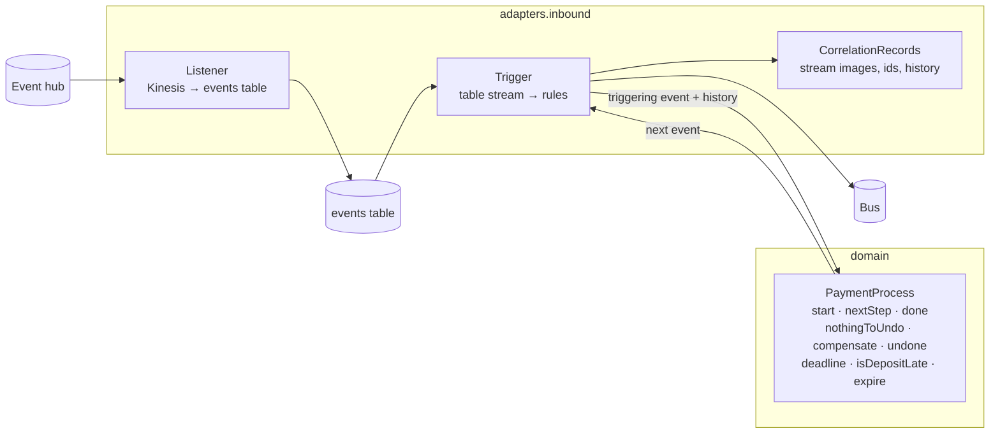
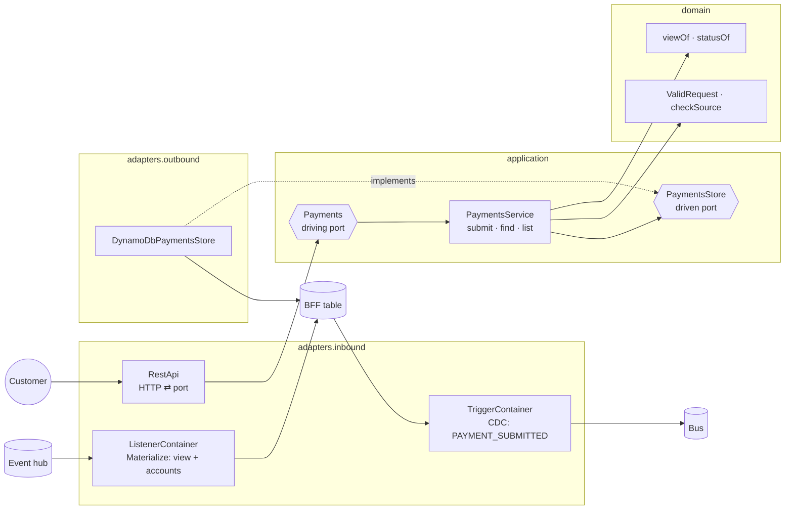
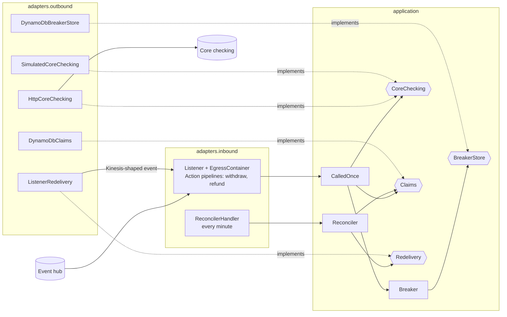

# Hexagonal architecture with kopipes

This example shows how to write a **hexagonal, event-driven application** with kopipes. It works at two levels:

- **The system.** Each service is an autonomous hexagon. Services never call each other: they talk only through
  events on the hub. External systems (core checking, the card processor, the bank network) are reached only through
  gateways, which are the system's adapters to the outside world.
- **Inside each service.** Business rules and use cases sit in the middle, in plain Kotlin. Lambda, Kinesis,
  DynamoDB, HTTP and kopipes itself sit around them as adapters.

This document is about the second level: how a service is cut, and where each kopipes concept fits.

## The layers

Every restructured service uses the same packages, under `org.myorg.payments`:

| Package              | Holds                                                                       | May depend on                                    |
|----------------------|-----------------------------------------------------------------------------|--------------------------------------------------|
| `domain`             | Business rules: given these facts, what comes next. Pure functions and values | the event model, the standard library            |
| `application`        | Use cases and policies, plus the **ports** they need (interfaces)            | the domain, kopipes core types, coroutines, logging |
| `adapters.inbound`   | Driving adapters: Lambda handlers, kopipes pipelines, REST, the composition root | anything                                       |
| `adapters.outbound`  | Driven adapters: the ports implemented on DynamoDB, HTTP, Lambda, SQS, simulations | anything                                     |

The event model (`common-app`: `Payment`, `PaymentsEvent`, the codec) is the **shared language**. Every layer of
every service uses it.

Dependencies point inwards only. `ArchitectureTest` checks this in each service, using the shared
[`Layering`](common-app/src/testFixtures/kotlin/org/myorg/payments/Layering.kt) fixture:

- `domain` may not import `io.kopipes.*`, AWS (`aws.*`, `com.amazonaws.*`, `software.amazon.*`), adapters or the
  application layer;
- `application` may not import `io.kopipes.aws.*`, AWS or adapters.

Plant `import io.kopipes.core.UnitOfWork` in a domain file and the build fails.

### How much inside a service has

Not every service needs every layer. The layers a service has say something about what it is:

| Service                           | `domain` | `application` | Why                                                                                   |
|-----------------------------------|:--------:|:-------------:|---------------------------------------------------------------------------------------|
| Control service                   | ✔        |               | It *is* a business process: rules over events, nothing to orchestrate besides them     |
| BFF                               | ✔        | ✔             | Customer use cases (submit, find, list) over its own state, plus the view rules       |
| Core checking egress gateway      |          | ✔             | No business of its own; its inside is the **policy** for calling an unreliable system  |
| Core checking ingress gateway     |          |               | An anti-corruption layer: it only translates. It is all adapter                        |

## Mapping kopipes onto ports and adapters

| kopipes / AWS concept                                                    | Hexagonal role                                                                                       |
|--------------------------------------------------------------------------|-------------------------------------------------------------------------------------------------------|
| Lambda handler (`Listener`, `Trigger`, `RestApi`, `ReconcilerHandler`)   | Entry point of a **driving adapter**. Converts the AWS event and hands it to a container               |
| `PipelineAssembler`, `KinesisAdapter`, `DynamodbAdapter`                 | Driving adapter plumbing: records in, units of work out                                               |
| A pipeline (`Collect`, `Correlate`, `Evaluate`, `Materialize`, `Cdc`, `Action`, `Translate`) | **Adapter.** It holds the plumbing (filters, ids, ordering, retries). Its lambdas (`emit`, `action`, `expression`) are where the adapter calls the inside |
| `UnitOfWork`                                                             | Adapter-only. It never crosses into the domain, which sees events. The control service unwraps it with `triggering()` and `correlatedEvents()` |
| Event (`PaymentsEvent` implementing kopipes `Event`)                     | The shared language: it crosses every layer. *Trade-off:* the model implements kopipes' `Event` (its envelope: id, timestamp, partition key, raw). That makes the event both the domain's language and the framework's message |
| `EventsMicrostore` and correlation                                       | The adapter's memory. It gathers a payment's history and passes it to the domain as a list of events   |
| `EventPublisher`, the bus                                                | A driven port that kopipes provides. Adapters use it (CDC triggers, translators). Use cases don't: accepting a payment *is* publishing it, through the table's change stream (no dual write) |
| `FaultManager`, `isRetryable`                                            | Composition-root configuration. The inside throws **typed** exceptions (`CallNotSent`, `CoreCheckingUnavailable`, `CallUnresolved`, `CannotDecide`). The root decides which ones the stream retries and which ones become faults |
| `XxxContainer.build()`                                                   | The **composition root**: it picks real or simulated adapters and plugs them into the ports           |
| CDK stack (`handler = "…adapters.inbound.Listener::handleRequest"`)      | Deployment wiring of the driving adapters                                                              |

The rule of thumb: **kopipes is how events get in and out; it is never what decides.** If a pipeline lambda grows an
`if` about the business, move that code inward.

## The services as hexagons

### Control service: a pure domain behind the pipelines

[`PaymentProcess`](payments-control-service/app/src/main/kotlin/org/myorg/payments/domain/PaymentProcess.kt) is the
saga as plain functions. A fact comes in and the next event goes out, for example
`start(PaymentSubmitted) = WithdrawalRequested`. The rule that needs history, `undone`, gets the payment's events as
a `List<PaymentsEvent>`. Its tests (`PaymentProcessTest`) use no stream records, tables or framework.

The pipelines keep all the kopipes-specific work: correlation, deterministic ids (`<payment>.<rule>`), the
deadline's TTL item and its expiry. That is why replays, redeliveries and timeouts behave exactly as before.

### BFF: use cases behind a driving port

- `RestApi` only maps HTTP to the port and back: headers, routing, query parameters, opaque cursors, status codes.
  `PaymentsService` knows nothing about any of these. It returns `Submission.Accepted | Invalid | Conflict` and a
  `PaymentsList` whose `next` is a `PaymentKey`, not a cursor string.
- The use cases are tested through the port with an in-memory store (`PaymentsServiceTest`). The REST tests check
  only the HTTP mapping.
- `PaymentsStore` has no "publish" method. Accepting a payment writes the item, and the table's stream publishes
  `PAYMENT_SUBMITTED` (the CDC trigger, an adapter). The port says *what*. *That it is also published* is the
  adapters' guarantee.

### Core checking egress gateway: a policy and its ports

A gateway has no business domain. Its inside is the **reliability policy**:

- never call twice blindly: claim, call, mark `SENT`;
- settle doubt by inquiry, never by calling again;
- stop calling while core checking is down or closed;
- redeliver what is in doubt.

All of it is tested against fakes of the four ports. Real core checking and the simulated one are two adapters of
the same port, so the simulation's fault accounts (C-5, C-7, C-8) are adapter tests.

### Core checking ingress gateway: all adapter

It hears the ledger through change data capture, translates each row into one of our events, and publishes it. It
decides nothing, so it has no inside to protect. Its `ArchitectureTest` asserts exactly that. If a gateway ever
starts making decisions, that is a sign the decision belongs in a service.

## Recipes

**Add a business rule to the control service.**
1. Add a function to `PaymentProcess` and test it in `PaymentProcessTest`.
2. Add a pipeline in `TriggerContainer`:
   `rule(Rules.X, TRIGGER) { listOf(PaymentProcess.x(it.triggering())) }`.
3. Add the rule id to `Rules`. It becomes part of the emitted event's id.

**Add a customer use case to the BFF.**
1. Add a method to `Payments` and implement it in `PaymentsService`. Test it with `InMemoryPaymentsStore`.
2. If the method needs data, extend `PaymentsStore` and implement it in `DynamoDbPaymentsStore`.
3. Map it to HTTP in `RestApi`.

**Restructure another egress gateway** (card processor, bank network) on the core checking template.
1. Move the call policy (rate limiting, called-once) into `application`, behind a port for the external system.
2. Move the HTTP client and the simulation into `adapters.outbound`.
3. Move the pipelines, handlers and `build()` into `adapters.inbound`.
4. Update the stack's handler names.
5. Add an `ArchitectureTest`.

## Status and trade-offs

- **Restructured so far:**
  - the control service;
  - the BFF;
  - the core checking egress and ingress gateways.
- **Still flat** (`org.myorg.payments`):
  - the card processor and bank network gateways;
  - the accounts ingress gateway;
  - the payments egress gateway;
  - the fault monitor.

  They behave correctly but haven't been cut into layers yet. The core checking pair is the template.
- **`common-gateway`** (the `ActionPipeline` and `TranslatePipeline` flavors, the external formats, the simulation
  helpers) is a library of adapter building blocks. It stays in the base package.
- **Events implement kopipes' `Event`.** A purist would keep a framework-free domain event and map it at the edge.
  Here that would mean a second, parallel model for every event, in a system whose whole contract is its events.
  The example accepts the dependency on the envelope instead. The `domain` rule still forbids importing kopipes
  directly.
- **The import check is lightweight on purpose.** It reads `import` lines rather than bytecode, so it adds no new
  dependency, such as ArchUnit. Fully qualified names in code would slip past it.
